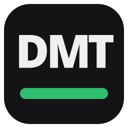
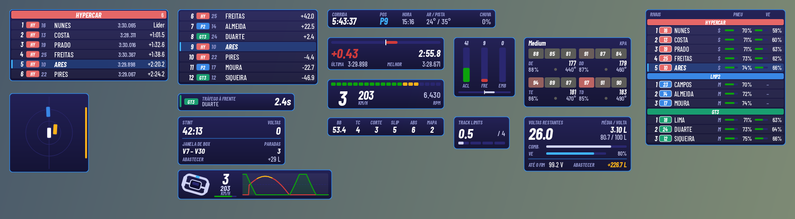
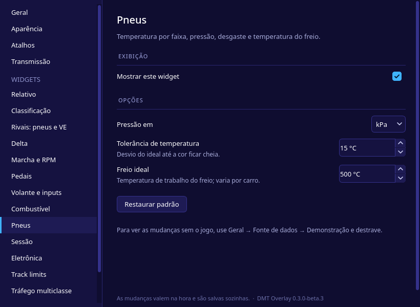
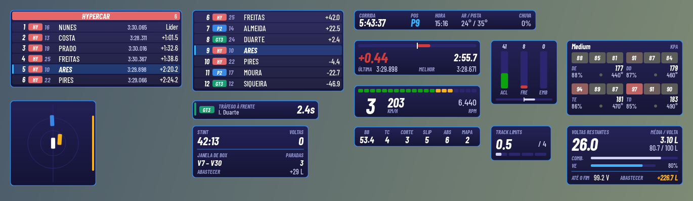
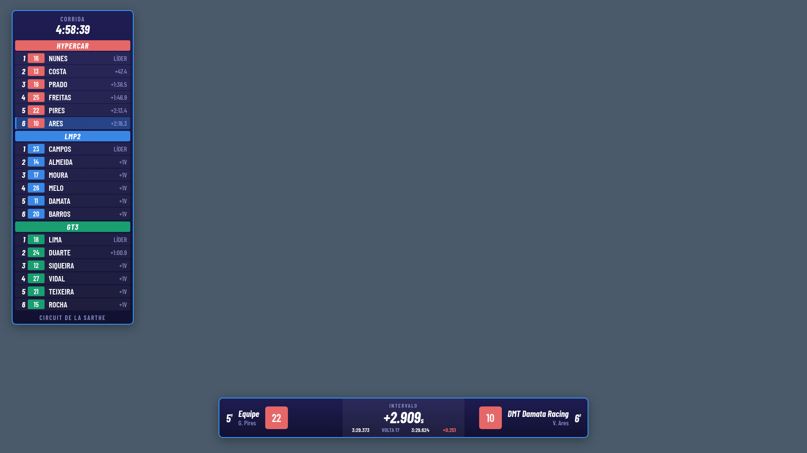

  

<h1 align="center">DMT Overlay</h1>

  Overlays leves de telemetria para <b>Le Mans Ultimate</b>, feitos pela <b>DMT - Damata Racing</b>.

  
  
  
  

## Widgets

Todos ligam, desligam e se ajustam em **Configurações**. Os marcados com * vêm desligados.

**Pilotagem**

| Widget | O que mostra |
|---|---|
| **Marcha e RPM** | Marcha, velocidade, RPM e luzes de troca. Avisa o limitador de box. |
| **Pedais** | Acelerador, freio, embreagem e volante, com TC e ABS atuando. |
| **Volante e inputs*** | Volante girando com a marcha no centro e anel de RPM, mais o gráfico do acelerador e do freio nos últimos segundos (amarelo com ABS ou TC). |
| **Delta** | Delta para a sua melhor volta, volta atual (vermelha se invalidada), última e melhor. |
| **Eletrônica** | Balanço de freio, TC, corte e slip, ABS e mapa de motor. |
| **Track limits** | Pontos acumulados e quanto falta para a punição. |

**Corrida e tráfego**

| Widget | O que mostra |
|---|---|
| **Relativo** | Carros à frente e atrás na pista. Vermelho = uma volta à sua frente, azul = uma volta atrás. |
| **Classificação** | Sua classe: líderes e quem está perto de você, última volta e distância para o líder. |
| **Radar** | Aparece com carro por perto e acende a lateral quando há alguém lado a lado. |
| **Alerta multiclasse** | Carro mais rápido de outra classe chegando, ou tráfego lento logo à frente. |
| **Sessão** | Tempo ou voltas restantes, posição, hora na pista, temperaturas e chuva. |

**Estratégia**

| Widget | O que mostra |
|---|---|
| **Combustível** | Voltas restantes (combustível e energia virtual), média por volta e quanto abastecer. |
| **Stint e estratégia** | Tempo e voltas do stint, janela de box e paradas restantes. |
| **Pneus** | Temperatura por faixa, pressão, desgaste e freio. Azul = frio, vermelho = quente. |
| **Rivais: pneus e VE*** | Pneu e energia virtual do topo da sua classe: 5 no Hypercar, 3 no LMP2 e no LMGT3. Online pode aparecer "–" se o jogo não mandar. |

## Instalação

1. Baixe o `.zip` em **[Releases](https://github.com/Vinii225/dmt-overlay/releases/latest)** e extraia em qualquer pasta.
2. Abra `DMT Overlay.exe`. O ícone aparece na bandeja, ao lado do relógio.
3. No LMU: **Settings → Gameplay → Enable Plugins: ON** e vídeo em **Borderless**. Em tela cheia exclusiva nada fica por cima do jogo.

> Na primeira vez o SmartScreen pode avisar, porque o executável não é assinado: **Mais informações → Executar assim mesmo**.

Para atualizar, extraia a versão nova por cima da antiga. Posições e opções ficam em `%APPDATA%\DMT Overlay\` e não se perdem. O app avisa quando sai versão estável nova.

## Uso

Botão direito no ícone da bandeja:

- **Travar posições**: destrave para arrastar (os widgets encaixam nas bordas) e trave para o clique passar para o jogo. Duplo clique no ícone faz o mesmo.
- **Esconder overlays**, **Widgets** (liga e desliga), **Abrir voltas gravadas** e **Configurações…**.

| Atalho | Ação |
|---|---|
| `Ctrl+Shift+H` | Esconder / mostrar os overlays |
| `Ctrl+Shift+L` | Travar / destravar posições |

Os atalhos funcionam com o jogo em foco e podem ser trocados em **Configurações → Atalhos**.

### Configurações

Tudo vale na hora e salva sozinho. Para posicionar sem abrir o jogo, use **Geral → Fonte de dados → Demonstração**.

- **Geral**: layout separado por classe, esconder fora da pista, fonte de dados, taxa de atualização, gravação das voltas e aviso de atualização.
- **Aparência**: tema, tamanho (80% a 150%) e opacidade.
- **Transmissão**: HUD para OBS e modo narrador.
- **Uma página por widget**: as opções dele (unidades, carros no relativo, luz de troca, alcance do radar…) e **Restaurar padrão**.

**Layout por classe**: cada classe (Hypercar, LMP2, GT3…) guarda as próprias posições e widgets ligados, e a troca é automática quando você entra com outro carro.

### Tema Transmissão

**Aparência → Tema → Transmissão** muda as cores e o estilo de todos os widgets para o visual de TV: azul-marinho, fonte condensada, sobrenomes em caixa alta e faixa da classe.

### HUD para transmissão (OBS)

Torre de classificação e caixa de briga com o carro da frente, para quem assiste.

1. **Configurações → Transmissão → Ligar HUD de transmissão** → **Copiar endereço** (padrão `http://localhost:8770`).
2. No OBS: **Fontes → + → Navegador**, cole o endereço, largura `1920` e altura `1080`.

O fundo é transparente e o HUD some quando o jogo desconecta. Transmite de outro PC? Ligue **Acessar de outro computador** e use o IP mostrado.

**Modo narrador**: ligue em **Transmissão → Modo narrador** e assista a corrida como espectador. Widgets e HUD seguem a **briga mais apertada** (troca sozinha, sem ficar pulando), o **líder** ou um **carro pelo número**. Pedais e volante ficam vazios, porque o jogo só manda essa telemetria do seu carro.

### Voltas gravadas

Cada volta completa vira uma linha em `%APPDATA%\DMT Overlay\voltas\`, um CSV por sessão, pronto para o Excel em português (`;` e vírgula decimal). Traz tempo, stint, posição, consumo de combustível e energia virtual, temperatura, pressão e desgaste dos pneus, e as condições da pista.

Um stint novo começa quando há serviço no box. Na volta do serviço, consumo e desgaste ficam em branco; a primeira volta depois de abrir o app fica de fora.

### Arquivos

Em `%APPDATA%\DMT Overlay\` (**Geral → Abrir pasta de configuração**): `config.json` (posições e opções), `voltas\*.csv` e `dmt-overlay.log`, que você anexa ao abrir uma issue de bug.

## Roadmap e contribuição

O planejamento fica no [kanban público](https://github.com/users/Vinii225/projects/5) e ideias e bugs entram por [issues](https://github.com/Vinii225/dmt-overlay/issues/new/choose). Para rodar o código, criar widgets e fazer releases, veja o [CONTRIBUTING.md](CONTRIBUTING.md).

## Créditos

- Fonte do tema Transmissão: [Barlow Condensed](https://github.com/jpt/barlow) (SIL Open Font License).
- Mapeamento da memória compartilhada do LMU: [pyLMUSharedMemory](https://github.com/TinyPedal/pyLMUSharedMemory) (MIT).
- Inspirado no [TinyPedal](https://github.com/TinyPedal/TinyPedal).

Le Mans Ultimate é marca da Studio 397 / Motorsport Games. Este projeto não tem ligação oficial com eles.
