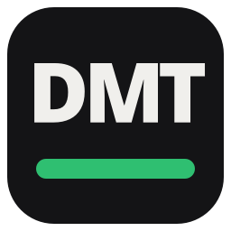
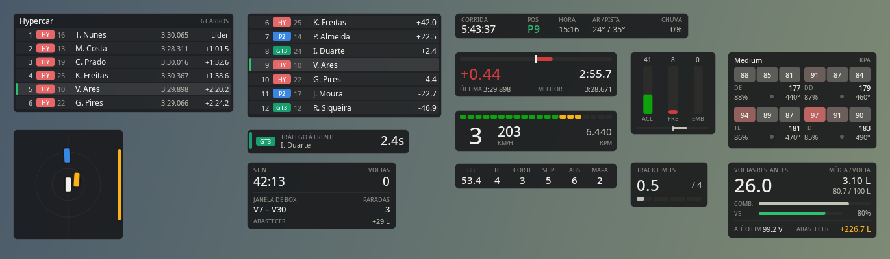

<p align="center">
  
</p>

<h1 align="center">DMT Overlay</h1>

<p align="center">
  Overlays leves de telemetria para <b>Le Mans Ultimate</b>, feitos pela <b>DMT - Damata Racing</b>.
</p>

<p align="center">
  <a href="https://github.com/Vinii225/dmt-overlay/releases/latest"></a>
  <a href="https://github.com/Vinii225/dmt-overlay/actions/workflows/ci.yml"></a>
  
  <a href="LICENSE"></a>
</p>



## Widgets

| Widget | O que mostra |
|---|---|
| **Relativo** | Carros à frente e atrás na pista, com classe, número e diferença em segundos. Nome em vermelho = uma volta à sua frente, em azul = uma volta atrás. |
| **Classificação** | Classificação da sua classe (líderes + quem está perto de você), última volta e distância para o líder. |
| **Delta** | Delta para a sua melhor volta, tempo da volta atual (vermelho se invalidada), última e melhor volta. |
| **Marcha e RPM** | Marcha, velocidade, RPM e luzes de troca que piscam no limite. Indica limitador de box ligado. |
| **Pedais** | Acelerador, freio, embreagem e volante. Mostra TC e ABS atuando. |
| **Combustível** | Voltas restantes (considerando combustível e energia virtual), média por volta, quanto falta até o fim e quanto abastecer. |
| **Pneus** | Temperatura por faixa (esquerda/centro/direita), pressão, desgaste e temperatura do freio. Azul = frio, cinza = ideal, vermelho = quente. |
| **Sessão** | Tipo de sessão, tempo ou voltas restantes, posição, hora na pista, temperatura e chuva. |
| **Eletrônica** | Balanço de freio, TC, corte e slip do TC, ABS e mapa de motor. |
| **Track limits** | Pontos de track limits acumulados e quanto falta para a punição. |
| **Alerta multiclasse** | Só aparece quando precisa: carro mais rápido de outra classe chegando por trás, ou tráfego mais lento logo à frente. |

## Instalação

1. Baixe o `.zip` mais recente em **[Releases](https://github.com/Vinii225/dmt-overlay/releases/latest)**.
2. Extraia em qualquer pasta, por exemplo `Documentos\DMT Overlay`.
3. Abra `DMT Overlay.exe`. O ícone aparece na bandeja do sistema, ao lado do relógio.

### Configuração do LMU

- **Settings → Gameplay → Enable Plugins**: `ON`. É isso que libera a memória compartilhada que o overlay lê. Não precisa instalar plugin nenhum.
- **Vídeo em Borderless (janela sem bordas)**. Em tela cheia exclusiva o Windows não deixa nenhuma janela ficar por cima do jogo.

> O Windows SmartScreen pode avisar na primeira vez, porque o executável não é assinado. Clique em **Mais informações → Executar assim mesmo**.

## Uso

Clique com o botão direito no ícone da bandeja:

- **Travar posições**: destrave para arrastar os widgets (eles encaixam nas bordas da tela) e trave de novo para o clique passar para o jogo. Atalho: duplo clique no ícone.
- **Widgets**: liga e desliga cada um.
- **Aparência**: tamanho (80% a 150%) e opacidade.
- **Esconder fora da pista**: some com os overlays no menu e na garagem.
- **Fonte de dados → Demonstração**: dados simulados para posicionar tudo sem abrir o jogo.
- **Avisar sobre atualizações**: ao abrir, o app confere se saiu versão nova e mostra um aviso com o link para baixar.

Posições e opções ficam salvas em `%APPDATA%\DMT Overlay\config.json`. Opções extras de cada widget (unidade de pressão em psi, km/h ou mph, número de carros no relativo, etc.) podem ser editadas nesse arquivo com o app fechado.

## Desenvolvimento

Requer Python 3.11 ou mais novo.

```bash
git clone git@github.com:Vinii225/dmt-overlay.git
cd dmt-overlay
python -m venv .venv
.venv\Scripts\activate          # Linux: source .venv/bin/activate
pip install -e ".[dev]"

python run.py --demo            # abre com dados de demonstração
pytest                          # testes
ruff check .                    # lint
python scripts/previa.py        # atualiza docs/previa.png
python scripts/build.py         # gera o .exe em dist/
```

### Estrutura

```
dmt_overlay/
├── telemetria/   leitura do LMU (memória compartilhada) e fonte de demonstração
├── calculos/     relativo, combustível e formatação
├── widgets/      um arquivo por overlay, todos herdam de base.WidgetOverlay
├── provedor.py   lê a fonte no ritmo configurado e distribui os quadros
├── bandeja.py    menu do ícone na bandeja
└── config.py     configuração em JSON
```

Para criar um widget novo, herde de `WidgetOverlay`, implemente `preparar` (extrai só os dados exibidos; o widget só redesenha quando eles mudam) e `desenhar`, e registre em `widgets/__init__.py`.

Veja [CONTRIBUTING.md](CONTRIBUTING.md) para o fluxo de branches e commits.

## Créditos

- Mapeamento da API de memória compartilhada do LMU: [pyLMUSharedMemory](https://github.com/TinyPedal/pyLMUSharedMemory) (MIT).
- Inspirado no [TinyPedal](https://github.com/TinyPedal/TinyPedal).

Le Mans Ultimate é marca da Studio 397 / Motorsport Games. Este projeto não tem ligação oficial com eles.
