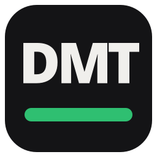
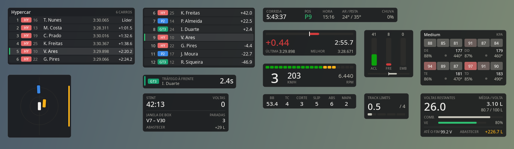
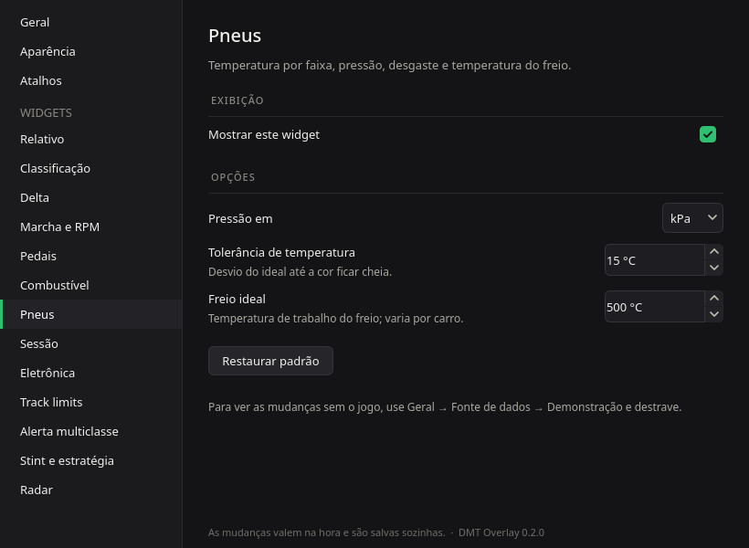

<p align="center">
  
</p>

<h1 align="center">DMT Overlay</h1>

<p align="center">
  Overlays leves de telemetria para <b>Le Mans Ultimate</b>, feitos pela <b>DMT - Damata Racing</b>.
</p>

<p align="center">
  <a href="https://github.com/Vinii225/dmt-overlay/releases/latest"></a>
  <a href="https://github.com/Vinii225/dmt-overlay/actions/workflows/ci.yml"></a>
  
  <a href="LICENSE"></a>
</p>



## Widgets

| Widget | O que mostra |
|---|---|
| **Relativo** | Carros à frente e atrás na pista, com classe, número e diferença em segundos. Nome em vermelho = uma volta à sua frente, em azul = uma volta atrás. |
| **Classificação** | Classificação da sua classe (líderes + quem está perto de você), última volta e distância para o líder. |
| **Delta** | Delta para a sua melhor volta, tempo da volta atual (vermelho se invalidada), última e melhor volta. |
| **Marcha e RPM** | Marcha, velocidade, RPM e luzes de troca que piscam no limite. Indica limitador de box ligado. |
| **Pedais** | Acelerador, freio, embreagem e volante. Mostra TC e ABS atuando. |
| **Combustível** | Voltas restantes (considerando combustível e energia virtual), média por volta, quanto falta até o fim e quanto abastecer. |
| **Pneus** | Temperatura por faixa (esquerda/centro/direita), pressão, desgaste e temperatura do freio. Azul = frio, cinza = ideal, vermelho = quente. |
| **Sessão** | Tipo de sessão, tempo ou voltas restantes, posição, hora na pista, temperatura e chuva. |
| **Eletrônica** | Balanço de freio, TC, corte e slip do TC, ABS e mapa de motor. |
| **Track limits** | Pontos de track limits acumulados e quanto falta para a punição. |
| **Stint e estratégia** | Tempo e voltas do stint, janela de box (primeira e última volta para parar), paradas restantes e quanto abastecer de combustível e energia virtual. |
| **Radar** | Só aparece com carro por perto (15 m por padrão, ajustável): mostra os carros ao redor na cor da classe e acende a lateral quando há alguém lado a lado. |
| **Alerta multiclasse** | Só aparece quando precisa: carro mais rápido de outra classe chegando por trás, ou tráfego mais lento logo à frente. |

## Instalação

1. Baixe o `.zip` mais recente em **[Releases](https://github.com/Vinii225/dmt-overlay/releases/latest)**.
2. Extraia em qualquer pasta, por exemplo `Documentos\DMT Overlay`.
3. Abra `DMT Overlay.exe`. O ícone aparece na bandeja do sistema, ao lado do relógio.

### Configuração do LMU

- **Settings → Gameplay → Enable Plugins**: `ON`. É isso que libera a memória compartilhada que o overlay lê. Não precisa instalar plugin nenhum.
- **Vídeo em Borderless (janela sem bordas)**. Em tela cheia exclusiva o Windows não deixa nenhuma janela ficar por cima do jogo.

> O Windows SmartScreen pode avisar na primeira vez, porque o executável não é assinado. Clique em **Mais informações → Executar assim mesmo**.

## Uso

Clique com o botão direito no ícone da bandeja. O menu tem só o que se usa durante a sessão:

- **Travar posições**: destrave para arrastar os widgets (eles encaixam nas bordas da tela) e trave de novo para o clique passar para o jogo. Atalho: duplo clique no ícone.
- **Esconder overlays**: some com todos os widgets na hora, sem desligar nenhum.
- **Widgets**: liga e desliga cada um.
- **Abrir voltas gravadas**: abre a pasta dos CSV (veja abaixo).
- **Configurações…**: abre a janela com todo o resto.

### Configurações

Tudo vale na hora e é salvo sozinho, sem botão de salvar.



- **Geral**: travar e restaurar posições, layout separado por classe, esconder fora da pista, fonte de dados (**Demonstração** simula dados para posicionar tudo sem abrir o jogo), taxa de atualização, gravação das voltas e aviso de atualização.
- **Aparência**: tamanho (80% a 150%) e opacidade.
- **Atalhos**: clique no campo e aperte a combinação nova.
- **Uma página por widget**: liga e desliga, além das opções dele (unidade de pressão e velocidade, carros no relativo, luz de troca, alcance do radar, temperatura ideal do freio, etc.) com **Restaurar padrão**.

### Layout por classe

Ligue **Configurações → Geral → Layout separado por classe** para cada classe (Hypercar, LMP2, GT3…) ter as próprias posições e os próprios widgets ligados. Por exemplo, o radar mais à vista no GT3 e a energia virtual em destaque no Hypercar. A troca acontece sozinha quando você entra na pista com um carro de outra classe. As opções de cada widget (unidades, alcance etc.) continuam valendo para todas.

### Atalhos de teclado

Funcionam com o jogo em foco, sem precisar tirar a mão do volante por muito tempo:

| Atalho | Ação |
|---|---|
| `Ctrl+Shift+H` | Esconder / mostrar todos os overlays |
| `Ctrl+Shift+L` | Travar / destravar posições |

Para trocar, use **Configurações → Atalhos** (ou **Limpar** para desligar). Valem `Ctrl`, `Shift`, `Alt` e `Win` com uma letra, número, `F1`–`F24`, `Insert`, `Delete`, `Home`, `End`, `PgUp`, `PgDown`, `Pause` ou `Space`. Se outro programa já usa a combinação, a janela avisa e mantém o atalho anterior.

### Voltas gravadas

Com o jogo conectado, cada volta completa vira uma linha em `%APPDATA%\DMT Overlay\voltas\`, um arquivo por sessão (ex.: `2026-11-09_1530_Le-Mans_Corrida.csv`). O arquivo usa `;` e vírgula decimal, então abre direto no Excel em português; no Google Sheets, importe com separador ponto e vírgula.

Cada linha traz:

- **Volta**: stint, volta (total e dentro do stint), tempo, se foi válida, se passou pelo box e a posição.
- **Consumo**: combustível gasto na volta e no fim dela, e o mesmo para energia virtual (%).
- **Pneus** (DE, DD, TE, TD): temperatura média da volta, pressão, desgaste na volta e quanto resta.
- **Condições**: composto, temperatura da pista e do ar e chuva.

Um stint novo começa quando há serviço no box (abastecimento ou troca de pneu); passar pelo pit lane sem parar não conta. Na volta em que houve serviço, consumo e desgaste ficam em branco porque não dá para medir. A primeira volta depois de abrir o app também fica de fora, porque começou pela metade.

### Atualizações

Ao abrir, o app confere no GitHub se saiu versão nova. Se saiu, aparece um aviso ao lado do relógio e o item **Baixar nova versão** no topo do menu da bandeja, que abre a página da release. Para atualizar, baixe o `.zip`, feche o app e extraia por cima da pasta antiga: suas posições e opções ficam em `%APPDATA%` e não se perdem. Versões beta não geram aviso. Para desligar o aviso: **Configurações → Geral → Avisar sobre atualizações**.

### Onde ficam os arquivos

Tudo em `%APPDATA%\DMT Overlay\` (**Configurações → Geral → Abrir pasta de configuração**):

| Arquivo | O que é |
|---|---|
| `config.json` | Posições, widgets ligados, opções e atalhos |
| `voltas\*.csv` | Voltas gravadas, um arquivo por sessão |
| `dmt-overlay.log` | Log do app; anexe ao abrir uma issue de bug |

## Roadmap

O planejamento fica no [kanban público](https://github.com/users/Vinii225/projects/5): sprints de 2 semanas e uma release a cada 2 sprints. Ideias e bugs entram por [issues](https://github.com/Vinii225/dmt-overlay/issues/new/choose).

## Desenvolvimento

Requer Python 3.11 ou mais novo.

```bash
git clone git@github.com:Vinii225/dmt-overlay.git
cd dmt-overlay
python -m venv .venv
.venv\Scripts\activate          # Linux: source .venv/bin/activate
pip install -e ".[dev]"

python run.py --demo            # abre com dados de demonstração
pytest                          # testes
ruff check .                    # lint
python scripts/previa.py        # atualiza docs/previa.png
python scripts/build.py         # gera o .exe em dist/
```

### Estrutura

```
dmt_overlay/
├── telemetria/       leitura do LMU (memória compartilhada) e fonte de demonstração
├── calculos/         relativo, combustível, estratégia, multiclasse, radar e formatação
├── widgets/          um arquivo por overlay, todos herdam de base.WidgetOverlay
├── app.py            liga tudo: widgets, bandeja, atalhos e janela de configurações
├── provedor.py       lê a fonte no ritmo configurado e distribui os quadros
├── bandeja.py        menu do ícone na bandeja (ações de sessão)
├── configuracoes.py  janela de configurações, montada a partir dos metadados dos widgets
├── atalhos.py        atalhos globais (RegisterHotKey no Windows)
├── gravador.py       voltas em CSV
├── layouts.py        layout por classe
├── atualizacao.py    aviso de versão nova (API do GitHub)
├── config.py         configuração em JSON
└── tema.py           cores, fontes e cores das classes
```

### Criando um widget

1. Herde de `WidgetOverlay` e implemente `preparar` (extrai só os dados exibidos; o widget só redesenha quando eles mudam) e `desenhar`.
2. Preencha `descricao` e, para cada chave de `opcoes_padrao`, uma `Opcao` em `opcoes` com rótulo, ajuda, faixa e unidade. A janela de configurações se monta sozinha a partir disso, e um teste falha se faltar alguma.
3. Se a altura depender das opções, sobrescreva `tamanho_base`; `reconfigurar()` é chamado quando o usuário muda algo.
4. Registre em `widgets/__init__.py`.

```python
class Exemplo(WidgetOverlay):
    nome = "exemplo"
    titulo = "Exemplo"
    descricao = "Uma linha explicando o que o widget mostra."
    opcoes_padrao = {"alerta": 3.0}
    opcoes = {"alerta": Opcao("Alerta", "Quando ficar vermelho.", 1, 10, 0.5, " voltas")}
```

Veja [CONTRIBUTING.md](CONTRIBUTING.md) para o fluxo de branches e commits.

## Créditos

- Mapeamento da API de memória compartilhada do LMU: [pyLMUSharedMemory](https://github.com/TinyPedal/pyLMUSharedMemory) (MIT).
- Inspirado no [TinyPedal](https://github.com/TinyPedal/TinyPedal).

Le Mans Ultimate é marca da Studio 397 / Motorsport Games. Este projeto não tem ligação oficial com eles.
